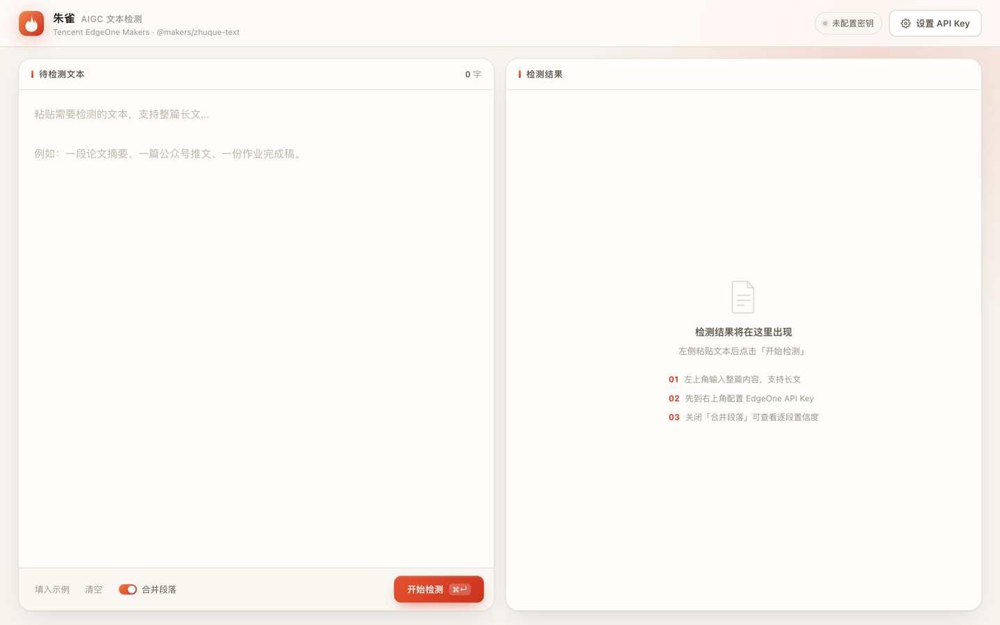
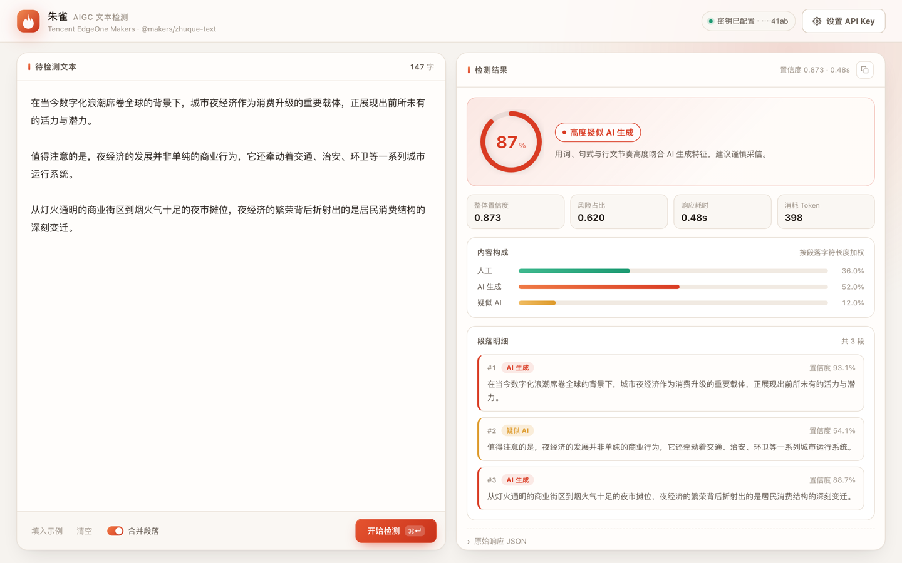
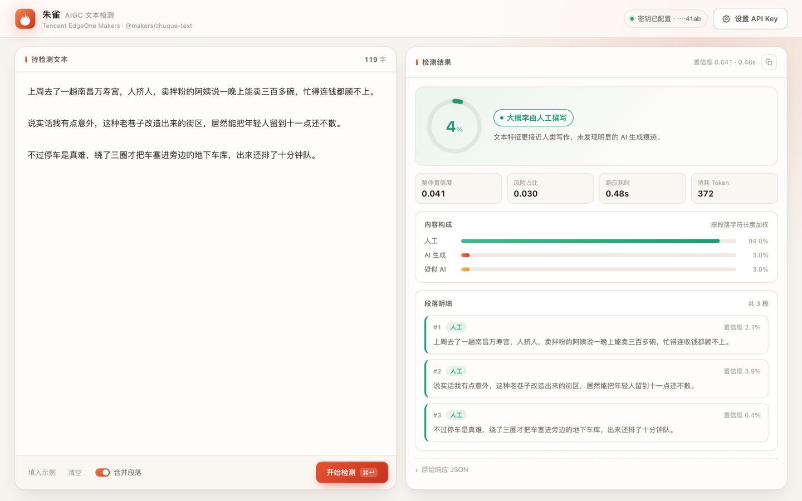
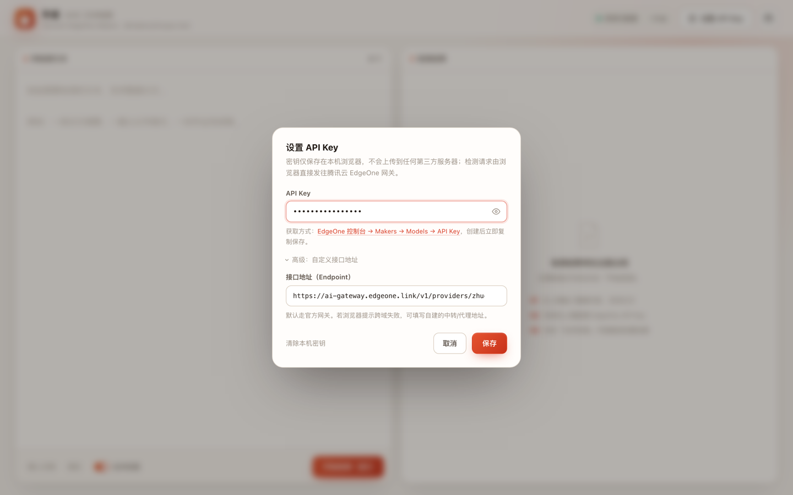

<div align="center">

# 朱雀 · AIGC 文本检测

**粘贴一段文字，立刻知道它更像人写的，还是 AI 写的。**

一个单文件、零依赖、零后端的网页工具 · 基于腾讯云 EdgeOne Makers 内置的朱雀（Zhuque）模型

[在线体验](https://zhuque-detect.anhao.app) · [快速开始](#快速开始) · [获取-API-Key](#获取-api-key) · [部署到-Cloudflare-Pages](#部署到-cloudflare-pages) · [工作原理](#工作原理)

</div>



---

## 这是什么

把腾讯云「朱雀」的 AIGC 文本检测能力，包成一个开箱即用的网页：**左边粘贴文本，右边给出判断**——整体置信度、人工 / AI / 疑似 AI 的占比、逐段结论，一屏看完。

整个应用就是一个 `index.html`，不依赖任何框架、构建工具或后端服务。双击就能用，也能直接丢到 Cloudflare Pages 上。

## 功能特性

| 能力 | 说明 |
| --- | --- |
| 整体判定 | 0–100% 置信度环形仪表盘，四档结论（人工 / 有 AI 参与迹象 / 较可能 AI / 高度疑似 AI） |
| 内容构成 | 人工、AI 生成、疑似 AI 三类占比条形图 |
| 逐段明细 | 关闭「合并段落」后，按段落输出各自标签与置信度，长文一眼定位可疑片段 |
| 密钥本地保存 | API Key 存在浏览器 `localStorage`，只在请求时作为 Bearer 头发给腾讯云网关 |
| 快捷操作 | `⌘/Ctrl + Enter` 直接检测，草稿自动保存，一键填入示例 |
| 结果导出 | 展开原始 JSON 并一键复制，便于二次处理 |
| 响应式 | 桌面双栏、移动端自动上下堆叠 |

## 界面预览

| 检测结果（AI 文本） | 检测结果（人工文本） |
| --- | --- |
|  |  |

<br>

<div align="center">
  
  <br>
  <sub>右上角「设置 API Key」，高级项里可以替换接口地址</sub>
</div>

## 快速开始

三步，不需要装任何东西。

1. **拿一个 API Key** —— 见下一节 [获取 API Key](#获取-api-key)。
2. **打开页面** —— 访问 <https://zhuque-detect.anhao.app>，或双击本仓库的 `index.html`。
3. **粘贴文本 → 点「开始检测」** —— 首次使用会提示你填入 Key。

想在本地起个服务（可选）：

```bash
git clone https://github.com/anhao/zhuque-detect.git
cd zhuque-detect
python3 -m http.server 8000
# 浏览器打开 http://localhost:8000
```

## 获取 API Key

朱雀模型的调用走 **EdgeOne Makers** 的 API Key，不是腾讯云账号的 SecretId / SecretKey。

1. 打开 [EdgeOne 控制台 → Makers](https://console.cloud.tencent.com/edgeone/makers?tab=models&subTab=apikey)，登录腾讯云账号。
2. 左侧菜单进入 **Makers**，切到 **Models → API Key** 标签页。
3. 点 **创建 API Key**，填一个名称（例如 `zhuque-web`）并确认。
4. 创建完成后**立即复制并保存**，页面不会再完整显示。
5. 回到本工具，点右上角 **设置 API Key**，粘贴后保存即可。

完成后在 **Models** 的内置模型列表里能看到 `@makers/zhuque-text`，标识为「内置模型」。

> **用量与额度**：朱雀模型的调用计入 Makers 每月 **50 万 token** 的免费额度，额度内可直接体验。
> 每次请求实际扣减的 token 数以响应里的 `makers_models_usage.total_tokens` 为准，可在 [Makers 概览](https://console.cloud.tencent.com/edgeone/makers?tab=models&subTab=overview) 查看用量。

## 部署到 Cloudflare Pages

纯静态单文件，三种方式任选。

### 方式一：连接 Git 仓库（推荐，可自动更新）

1. Cloudflare 控制台 → **Workers & Pages** → **Create** → **Pages** → **Connect to Git**。
2. 授权并选择本仓库。
3. 构建配置按下表填写——**不需要构建步骤**：

   | 配置项 | 值 |
   | --- | --- |
   | Framework preset | `None` |
   | Build command | 留空 |
   | Build output directory | `/` |
   | 环境变量 | 不需要 |

4. 点 **Save and Deploy**。之后每次 `git push`，Cloudflare 自动重新发布。

### 方式二：Wrangler CLI 直接上传

```bash
npx wrangler pages deploy . --project-name zhuque-detect
```

首次执行会提示登录并自动创建项目，输出里会给出 `https://zhuque-detect.pages.dev` 这样的地址。仓库里的 `wrangler.toml` 已经写好项目名和输出目录，之后只需：

```bash
npx wrangler pages deploy
```

### 方式三：拖拽上传

**Workers & Pages** → **Create** → **Pages** → **Upload assets**，把整个目录拖进去即可。

> 自定义域名：项目 → **Custom domains** → 添加你的域名，DNS 在 Cloudflare 托管时一条 CNAME 就够。

## 工作原理

页面通过一个 POST 请求直接调用 EdgeOne 的模型网关，浏览器与网关之间没有中间层。

```http
POST https://ai-gateway.edgeone.link/v1/providers/zhuque-text/classify
Authorization: Bearer <你的 API Key>
Content-Type: application/json
```

```json
{
  "text": "待检测的文本内容",
  "is_merge": true
}
```

| 参数 | 类型 | 必填 | 说明 |
| --- | --- | --- | --- |
| `text` | string | 是 | 待检测的文本 |
| `is_merge` | bool | 否 | 是否合并段落，默认 `true`；设为 `false` 时逐段输出置信度 |

响应关键字段：

| 字段 | 说明 |
| --- | --- |
| `softmax_confidence` | 整体置信度，**越大越可能是 AI 生成**（0–1） |
| `ratio_confidence` | 整体疑似风险内容占比（0–1） |
| `labels_ratio` | 三类内容占比：`"0"` 人工、`"1"` AI 生成、`"2"` 疑似 AI |
| `segment_labels` | 分段结果数组，含 `text` / `label` / `conf` / `order` / `position` |
| `makers_models_usage.total_tokens` | 本次调用实际扣减的免费额度 |

本工具的判定阈值：

| `softmax_confidence` | 结论 |
| --- | --- |
| ≥ 0.85 | 高度疑似 AI 生成 |
| 0.50 – 0.85 | 较可能为 AI 生成 |
| 0.20 – 0.50 | 存在 AI 参与迹象 |
| < 0.20 | 大概率由人工撰写 |

> 接口返回 `access-control-allow-origin: *`，浏览器可以跨域直连，所以不需要自建代理。

## 常见问题

**API Key 会不会被上传到别的地方？**
不会。Key 只存在你本机的 `localStorage`，请求从浏览器直接发往 `ai-gateway.edgeone.link`。仓库里没有任何后端，也没有埋点。

**部署到公网后，别人会用掉我的额度吗？**
不会。页面不自带 Key，每个访客填自己的 Key；没填就无法调用。

**提示「鉴权失败（401）」怎么办？**
说明 Key 无效或已被删除。回到 EdgeOne 控制台 → Makers → API Key 重新创建，注意复制完整、不要带多余空格。

**push 之后没有触发自动部署？**
说明 GitHub 授权没走完。到 Cloudflare 控制台 → 该项目 → **Settings → Builds & deployments**，确认仓库已授权、生产分支为 `main`；必要时在这一页重新连接一次 Git 仓库。也可以随时手动发布：

```bash
npx wrangler pages deploy . --project-name zhuque-detect
```

**检测准确率靠谱吗？**
模型给出的是概率判断，不是证据。短文本、专业术语密集的文本、经过人工润色的 AI 文本都可能误判，请结合上下文使用。

**能检测图片吗？**
当前模型接口只提供文本检测。图片检测可前往 [朱雀 AI 检测助手官网](https://matrix.tencent.com/ai-detect/)。需要企业级图片检测方案可联系腾讯云。

**额度用完了怎么办？**
在 Makers 概览查看用量。企业用户可通过腾讯云申请专属方案，个人用户可等待官方后续方案。

**想换成别的模型？**
点设置里的「高级：自定义接口地址」，改成分兼容的网关地址即可，返回结构保持一致。

## 项目结构

```
.
├── index.html          # 全部代码：结构、样式、逻辑
├── screenshots/        # README 配图
├── _headers            # Cloudflare Pages 响应头配置
├── wrangler.toml       # Pages 部署配置
├── LICENSE
└── README.md
```

## 说明

- 本项目仅封装腾讯云官方接口，模型能力与判定结果由腾讯云提供。
- 朱雀、EdgeOne 为腾讯云商标，本项目与腾讯云无隶属关系。
- 检测结果仅供参考，不构成任何形式的鉴定或法律依据。

## License

[MIT](LICENSE)
